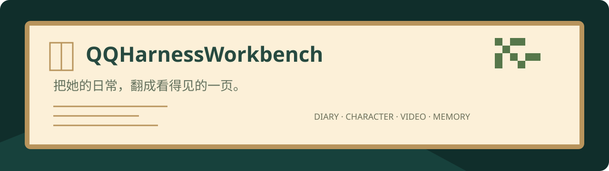
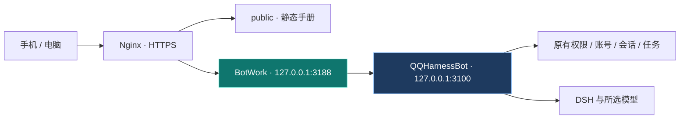

<div align="center">



# 📖 QQHarnessWorkbench

**把她的日常，翻成看得见的一页。**

日记、人设、视频与回忆，放进一本随时能翻开的私人手册。<br/>
从手机到电脑，让你看见机器人做了什么，也能直接给出方向。

<br/>


[](LICENSE)

**暖纸与木框 · 真实活动记录 · 同一套机器人指令**

[快速部署](README_DEVELOPER.md) · [AI执行手册](README_AI.md) · [配置地图](docs/CONFIGURATION.md) · [机器人主仓库](https://github.com/YZzy2006/QQHarnessBot)

</div>

---

> QQHarnessBot 的配套轻量工作台。使用原生 HTML / CSS / JavaScript 和 Node 内置 HTTP 网关，没有 React、Vue、前端构建工具或第二套机器人运行时。**需要配套的QQHarnessBot后端**；本仓库的网关不独立提供聊天、认证数据库或业务执行。

## 📌 从这里开始

| 我想…… | 阅读入口 |
| --- | --- |
| 在自己的域名上部署 | [开发者教程](README_DEVELOPER.md) |
| 交给AI协助部署维护 | [AI执行手册](README_AI.md) |
| 改聊天模型、天气、定位或语音 | [准确配置地图](docs/CONFIGURATION.md) |
| 接本地账号或独立MySQL账号 | [认证与可选OSS](docs/WORKBENCH-AUTH.md) |
| 确认需要哪个机器人版本 | [兼容版本清单](compatibility.json) |

## 🌿 一本手册，几个入口

| 📖 日记与动态 | 🎭 人设与能力 | 🎬 视频与兴趣 |
| --- | --- | --- |
| 阅读真实活动与明确生成的私人日记/周记 | 当前人物卡、生效内容、模型与会话设置 | 观看/分享记录、实际证据、选片偏好与引导 |
| 🧠 记忆与安排 | 💬 反馈与需求 | 🛠️ 操作与状态 |
| 回忆、待办、提醒和定时任务 | 查看角色反馈并留下处理意见 | 结构化指令、目标选择、执行结果与服务器状态 |

手机和电脑共用响应式界面。时间线、筛选和分页直接读取既有记录；刷新不会自动调用模型或发送消息。日记生成、主动对话、视频分析等操作会明确提示，并沿用原有权限、额度和费用边界。

### 不必再记每条QQ指令

```text
分享视频 → 填链接 → 选目标 → 查看实际执行结果
定时任务 → 选时间与会话 → 预览确认 → 查看待执行安排
功能设置 → 查看当前值 → 修改 → 原业务方法校验后保存
```

网页和QQ操作共用一份状态。管理员私有日记与周记不会因查看范围切换就进入群聊；当前登录能力面向管理员，不代表已经提供任意群友多租户账号体系。

## 🏗️ 轻量而清楚的部署关系



| 目录 | 用途 |
| --- | --- |
| `public/` | 直接部署的HTML、CSS、JavaScript与本地像素字体 |
| `server.mjs` | Node内置HTTP网关，只转发工作台API |
| `src/workbench-*.js` | 与机器人配套的后端模块源码参考；依赖主仓库运行环境 |
| `deploy/` | Nginx与systemd示例，使用前改为自己的域名和路径 |
| `docs/` | 配置、认证、许可和发布说明 |
| `scripts/` | 离线检查与明确文件清单发布工具 |

## 🚀 最短启动路径

先按[机器人教程](https://github.com/YZzy2006/QQHarnessBot/blob/main/README_DEVELOPER.md)准备唯一后端、工作台账号和Origin，然后：

```bash
git clone https://github.com/YZzy2006/QQHarnessWorkbench.git
cd QQHarnessWorkbench
npm ci
npm test
npm start
```

此时启动的是回环3188端口的API网关。网页由Nginx服务`public/workbench.html`，完整步骤见[开发者教程](README_DEVELOPER.md)。不要把端口3188当作自带HTML的独立应用，也不要公开整个旧机器人控制台。

## 🔐 私人手册，保持私人

- 仓库不提供维护者账号密码、Token、聊天记录、日记正文、人物卡、登录二维码或用户头像。
- 配置保存在你自己的机器；独立HttpOnly会话、CSRF和Origin校验在后端执行，不在前端保存全权控制台令牌。
- 可选MySQL/OSS适配需要你自己的独立配置与凭据；最小部署使用本地账号，无须维护者博客。
- 视频资料沿用72小时保留规则，过期不会因为翻页自动重看。只读列表不是新模型调用。

## 🧪 开发与发布

```bash
npm test
npm run check:release
```

网关测试使用隔离假后端；真实业务测试在主仓库运行。离线通过不等于所有QQ客户端和外部供应商已人工验收。发布前检查工作树、暂存区和历史，见[安全说明](SECURITY.md)。

## 🙏 来源与许可

工作台代码沿用[MIT](LICENSE)，具体第三方来源见[NOTICE.md](NOTICE.md)。本地像素字体来自Fusion Pixel Font，字体本身为OFL-1.1，声明与许可在[docs/licenses/fusion-pixel](docs/licenses/fusion-pixel/)；像素风界面并不捆绑商业游戏素材。

---

<div align="center">

**每一条记录，都有它的来处。**

[机器人主仓库](https://github.com/YZzy2006/QQHarnessBot) · [开发者部署](README_DEVELOPER.md) · [AI部署](README_AI.md)

</div>

> **会话视频设置**：档案里开关主动视频，视频页按私聊／群聊分别设置每日上限并查看今日用量。[设置说明](docs/CONFIGURATION.md#逐会话主动视频开关与限额)
